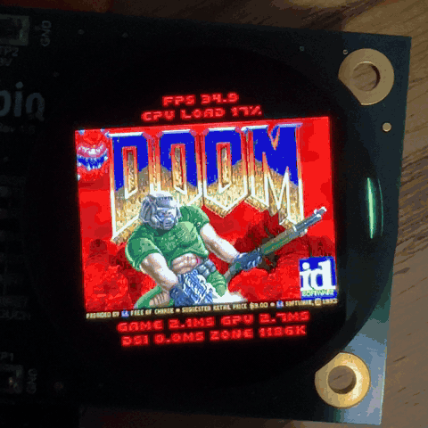
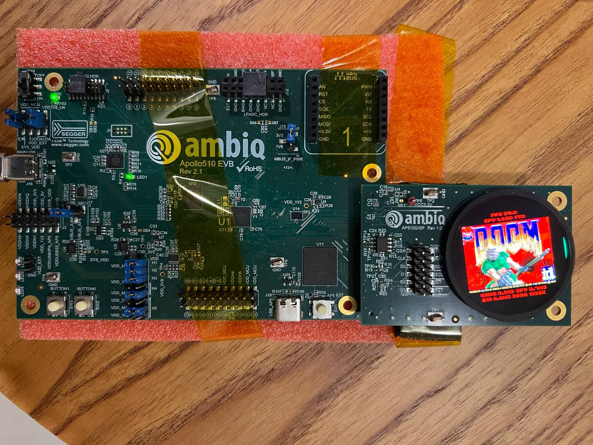

# Doom on the Apollo510 EVB

Doom (shareware episode) on an Ambiq Apollo510 EVB with the AP510DISP display card. The board boots into Doom's attract loop
(title screen, then demos 1–3) on the round AMOLED, with live metrics above and below the picture. No input and no sound.





## What you need

- Apollo510 EVB with the AP510DISP display card fitted.
- A USB cable from your PC to the EVB's on-board J-Link (the USB-C port next to the SEGGER logo).
- Linux (Fedora or Ubuntu tested) with `make`, `git` and Docker usable without sudo, and a udev rule that gives your user
  access to SEGGER probes (USB vendor `1366`). `make setup` checks all of this and prints the exact commands for anything that
  is missing.

The build runs in a container image built from `tools/Dockerfile`, as your user, so files in `build/` are yours. Building the
image downloads SEGGER J-Link and **accepts the SEGGER J-Link license** on your behalf.

## Usage

```
git clone git@github.com:mariobaldini/ambiq-ap510-doom.git
cd ambiq-ap510-doom
make setup     # once: check docker + udev rule, build the image, build the firmware
make flash     # build, then program the app and the WAD; the board restarts into Doom
make swo       # watch the log: boot messages, one metrics line per second (Ctrl-C to stop)
```

The first build fetches the submodules, the Arm toolchain (into `tools/`) and the shareware `doom1.wad`.

| Target       | What it does                                                        |
|--------------|---------------------------------------------------------------------|
| `make setup` | docker + udev checks, build the image, `make build`                 |
| `make build` | build into `build/`                                                 |
| `make flash` | build, then program the app and the 3.4 MB WAD (about 20 s)         |
| `make reset` | reset and start the board                                           |
| `make swo`   | show the SWO log                                                    |
| `make clean` | delete `build/` (toolchain, submodules and image stay)              |

Options:

- `DOOM_ARGS='-timedemo demo1'` passes extra Doom arguments (baked into the build). Example: `make flash DOOM_ARGS='-timedemo demo1'`
  plays demo 1 as fast as possible, then shows the result on screen.
- `JLINK_SN=<serial>` picks a probe when more than one is connected.

## On-screen metrics

Updated once per second, also printed on SWO:

| Metric     | Meaning                                                        |
|------------|----------------------------------------------------------------|
| `FPS`      | frames per second (the attract loop is capped at 35)           |
| `CPU LOAD` | time not sleeping                                              |
| `GAME`     | ms Doom spends per frame                                       |
| `GPU`      | ms the GPU spends scaling the frame through the palette        |
| `DSI`      | ms waiting for the previous frame to finish going to the panel |
| `ZONE`     | free Doom zone memory                                          |

Measured: the attract loop holds 35 FPS at about 25 % CPU load; `-timedemo demo1` runs at about 87 fps.

## How it works

- Doom renders its 320x200 8-bit screen on the CPU. The GPU scales it to 360x270 through the 256-colour palette into one of
  two 468x468 RGB888 framebuffers, and the display controller sends that frame over MIPI DSI while Doom renders the next one.
- `tools/wadprep.py` turns `doom1.wad` into `build/wad.bin`: sound and music data dropped, lumps 4-byte aligned, plus a CRC32
  header the firmware checks at boot. The WAD stays in MRAM and Doom reads lumps from there in place; the MPU makes it
  read-only.

```
doom/          doomgeneric
ambiq/         Ambiq HAL, CMSIS, NemaGFX (submodules)
src/           the port: startup, linker script, board, DSI panel, GPU, display, metrics, WAD in MRAM, newlib syscalls
tools/         Dockerfile, wadprep.py; the toolchain is downloaded here (ignored)
docs/          photos
firmware.mk    the build, run inside the container by Makefile
build/         all output (ignored): doom.elf/.bin/.map, wad.bin, J-Link scripts
```
